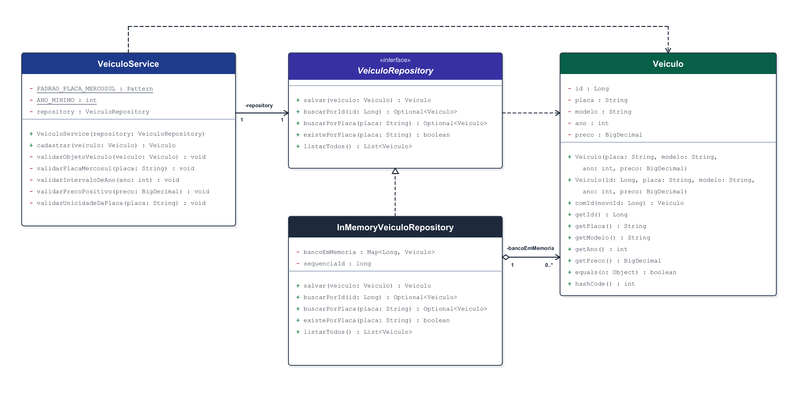

# Guia Prático de TDD em Java com JUnit 5: Cadastro de Veículos

Bem-vindo ao laboratório prático de **Test-Driven Development (TDD)**! Este repositório demonstra, passo a passo (*baby steps*), como desenvolver uma funcionalidade de negócio real em Java guiada inteiramente por testes unitários automatizados com **JUnit 5**.

---

## 1. O Problema e a História de Usuário

Uma revenda de automóveis precisa de um serviço para incluir veículos em seu estoque garantindo a integridade dos dados cadastrados.

> **História de Usuário:**  
> **Como** atendente da revenda,  
> **Quero** cadastrar um veículo informando placa, modelo, ano e preço,  
> **Para** disponibilizá-lo para venda no estoque da loja.

### Critérios de Aceitação (Regras de Negócio)
- **CA1:** A placa deve seguir o padrão Mercosul simplificado `AAA1A23` (3 letras maiúsculas, 1 número, 1 letra maiúscula e 2 números).
- **CA2:** O ano do veículo deve estar entre `1900` e o `ano atual + 1`.
- **CA3:** O preço deve ser estritamente maior que zero (`> 0`).
- **CA4:** Não pode existir outro veículo no estoque com a mesma placa (proibir duplicidade).
- **CA5:** Um cadastro válido deve receber um identificador único (`id`) e ficar persistido no estoque.

### Diagrama de Classes (Modelo Contextual de Negócio)

Para fins didáticos do projeto, o diagrama abaixo apresenta **somente o modelo contextual de classes de negócio** (`Veiculo`, `VeiculoRepository`, `InMemoryVeiculoRepository` e `VeiculoService`) concebido para representar a solução que atende à história de usuário apresentada, sem incluir classes de infraestrutura de testes, exceções ou detalhes de frameworks:

- [Diagrama de Classes em Alta Definição (PNG)](./diagrama_classes.png)
- [Diagrama de Classes Vetorial (SVG)](./diagrama_classes.svg)
- [Especificação do Diagrama em Mermaid e PlantUML (Markdown)](./diagrama_classes.md)



---

## 2. Entendendo a Dinâmica do TDD (Ciclo Red-Green-Refactor)

Para demonstrar fielmente o que deve ser implementado **primeiro** (o teste que falha) e o que vem **na sequência** (a implementação da regra), cada *baby step* foi dividido em dois diretórios:

1. 🔴 **`passo_N_erro` (Fase RED — Vermelho):**
   - Mantém o código de produção (`src/main/java`) exatamente como estava no passo anterior (`passo_N-1`), mas **adiciona o novo teste unitário** em `src/test/java`.
   - Ao executar `mvn clean test` nesta pasta, o aluno vê na prática que todos os testes anteriores continuam passando, mas o novo teste **falha** (`BUILD FAILURE`), provando que a regra ainda não existe.
2. 🟢 **`passo_N` (Fase GREEN — Verde):**
   - Contém a implementação da regra de negócio no código de produção (`VeiculoService` / `VeiculoRepository`) para satisfazer o teste recém-criado.
   - Ao executar `mvn clean test` nesta pasta, todos os testes passam (`BUILD SUCCESS`).
3. 🔵 **`passo_6` (Fase REFACTOR — Refatoração Final):**
   - Com todos os critérios cobertos pelos testes, refatoramos o design das classes de domínio (imutabilidade, encapsulamento, *Clean Code*) e organizamos a suíte de testes com `@Nested`.

---

## 3. Explicação Didática de Cada Passo (Par `passo_N_erro` → `passo_N`)

### 📁 `passo_0` — Estágio Inicial: Preparação e *Sanity Check*
- **O que este passo trata:** Garante que o projeto compila e que o motor de testes (JUnit 5) está funcionando antes de escrevermos qualquer regra de negócio.
- **Resultado ao rodar `mvn clean test`:** `Tests run: 1, Failures: 0` (`BUILD SUCCESS`).

---

### 🔴 `passo_1_erro` → 🟢 `passo_1` — Baby Step 1: O Caminho Feliz (CA5)
- **O que este passo trata:** Atende ao **CA5** (cadastrar um veículo válido, gerar um `id` e guardá-lo no estoque).
- **1º — O que acontece em `passo_1_erro` (RED):**
  - Escrevemos primeiro o teste `deveCadastrarVeiculoValidoGerandoIdentificadorEPersistindoNoEstoque()` em `VeiculoServiceTest`.
  - Para o teste compilar, criamos apenas as cascas (*stubs*) de `Veiculo`, `VeiculoRepository`, `InMemoryVeiculoRepository` e `VeiculoService`, onde `cadastrar()` ainda devolve o veículo sem gerar `id` nem salvar.
  - **Execução:** `Tests run: 1, Failures: 1` (`BUILD FAILURE` — falha na asserção `assertNotNull(cadastrado.getId())`).
- **2º — O que acontece na sequência em `passo_1` (GREEN):**
  - Implementamos a geração sequencial de ID (`sequenciaId++`) e o armazenamento no `Map` dentro de `InMemoryVeiculoRepository`, e fazemos `VeiculoService.cadastrar()` delegar para `repository.salvar(veiculo)`.
  - **Execução:** `Tests run: 1, Failures: 0` (`BUILD SUCCESS`).

---

### 🔴 `passo_2_erro` → 🟢 `passo_2` — Baby Step 2: Validação da Placa Mercosul (CA1)
- **O que este passo trata:** Rejeitar placas que não sigam o formato Mercosul `AAA1A23` (ex.: `ABC1234`, `abc1d23`, `ABC-1D23`, vazias ou nulas).
- **1º — O que acontece em `passo_2_erro` (RED):**
  - O `VeiculoService` continua idêntico ao do `passo_1` (sem validação de placa).
  - Criamos a classe `RegraNegocioException` e adicionamos o teste parametrizado `naoDeveCadastrarVeiculoComPlacaForaDoPadraoMercosul` em `VeiculoServiceTest`, esperando que o serviço lance `RegraNegocioException` para 9 entradas inválidas.
  - **Execução:** `Tests run: 10, Failures: 9` (`BUILD FAILURE` — o teste do CA5 passa, mas os 9 casos de placa inválida falham porque nenhuma exceção foi lançada).
- **2º — O que acontece na sequência em `passo_2` (GREEN):**
  - Adicionamos o método `validarPlaca(String placa)` com a Regex `^[A-Z]{3}[0-9][A-Z][0-9]{2}$` em `VeiculoService`.
  - **Execução:** `Tests run: 10, Failures: 0` (`BUILD SUCCESS`).

---

### 🔴 `passo_3_erro` → 🟢 `passo_3` — Baby Step 3: Validação do Ano do Veículo (CA2)
- **O que este passo trata:** Garantir que o veículo tenha ano entre `1900` e `ano atual + 1` aplicando **Análise de Valor Limite**.
- **1º — O que acontece em `passo_3_erro` (RED):**
  - O `VeiculoService` ainda é o do `passo_2` (só valida placa).
  - Adicionamos em `VeiculoServiceTest` os testes de fronteira: `1899` (deve falhar), `anoAtual + 2` (deve falhar) e os limites válidos `1900` e `anoAtual + 1` (devem passar).
  - **Execução:** `Tests run: 13, Failures: 2` (`BUILD FAILURE` — os 2 testes de anos inválidos `1899` e `anoAtual + 2` falham pois o serviço ainda permite cadastrá-los).
- **2º — O que acontece na sequência em `passo_3` (GREEN):**
  - Implementamos `validarAno(int ano)` em `VeiculoService` verificando `ano < 1900 || ano > Year.now().getValue() + 1`.
  - **Execução:** `Tests run: 13, Failures: 0` (`BUILD SUCCESS`).

---

### 🔴 `passo_4_erro` → 🟢 `passo_4` — Baby Step 4: Validação de Preço Positivo (CA3)
- **O que este passo trata:** Impedir o cadastro de veículos com preço `null`, zero (`0`, `0.00`) ou negativo (`-0.01`, `-50000.00`).
- **1º — O que acontece em `passo_4_erro` (RED):**
  - O `VeiculoService` ainda é o do `passo_3` (valida apenas placa e ano).
  - Adicionamos em `VeiculoServiceTest` os 5 casos de teste para preços inválidos (`null`, `0`, `0.00`, `-0.01`, `-50000.00`).
  - **Execução:** `Tests run: 18, Failures: 5` (`BUILD FAILURE` — todos os 13 testes anteriores passam, e exatamente os 5 novos testes de preço falham).
- **2º — O que acontece na sequência em `passo_4` (GREEN):**
  - Implementamos `validarPreco(BigDecimal preco)` em `VeiculoService` com `preco == null || preco.compareTo(BigDecimal.ZERO) <= 0`.
  - **Execução:** `Tests run: 18, Failures: 0` (`BUILD SUCCESS`).

---

### 🔴 `passo_5_erro` → 🟢 `passo_5` — Baby Step 5: Impedimento de Placa Duplicada (CA4)
- **O que este passo trata:** Impedir que dois veículos com a mesma placa sejam cadastrados no estoque.
- **1º — O que acontece em `passo_5_erro` (RED):**
  - O `VeiculoService` e o `VeiculoRepository` ainda são os do `passo_4`.
  - Adicionamos o teste `naoDeveCadastrarVeiculoComPlacaDuplicada()` em `VeiculoServiceTest`, que cadastra a placa `"BRA2E19"` duas vezes e espera `RegraNegocioException` na segunda chamada.
  - **Execução:** `Tests run: 19, Failures: 1` (`BUILD FAILURE` — os 18 testes anteriores passam, mas o 19º falha porque o segundo veículo duplicado foi salvo sem erro).
- **2º — O que acontece na sequência em `passo_5` (GREEN):**
  - Evoluímos `VeiculoRepository` e `InMemoryVeiculoRepository` com `existePorPlaca(String placa)` e adicionamos `validarDuplicidadePlaca` em `VeiculoService`.
  - **Execução:** `Tests run: 19, Failures: 0` (`BUILD SUCCESS`).

---

### 🔵 `passo_6` — Estágio Final: Refatoração Limpa (Clean Code) e Suíte Completa
- **O que este passo trata:** Com todos os critérios de aceitação (**CA1 a CA5**) atendidos e protegidos por testes, realizamos uma refatoração de consolidação tanto no código de produção quanto na suíte de testes:
  - `Veiculo` torna-se **imutável** (campos `final` e método `comId(Long novoId)`).
  - `VeiculoService` valida objetos nulos e apresenta métodos privados coesos.
  - `VeiculoServiceTest` é organizado em classes internas `@Nested` (uma para cada Critério de Aceitação), expandindo os casos de borda para **31 execuções de teste**.
- **Resultado ao rodar `mvn clean test`:** `Tests run: 31, Failures: 0` (`BUILD SUCCESS`).

---

## 4. Anotações e Estruturas do JUnit 5 Utilizadas no Projeto

Se você está estudando as classes `*Test.java` deste projeto, abaixo está o guia de referência de todas as anotações e métodos do **JUnit 5 (Jupiter)** empregados:

### 4.1. Anotações de Ciclo de Vida e Organização

| Anotação | Onde é usada | Para que serve? |
| :--- | :--- | :--- |
| `@Test` | Em métodos | Marca um método comum como um caso de teste executável pelo JUnit. |
| `@DisplayName("...")` | Em classes e métodos | Define um nome descritivo em português (com espaços e acentos) que aparece no relatório de execução, facilitando entender qual regra de negócio está sendo testada. |
| `@BeforeEach` | No método `setUp()` | Indica que aquele método deve ser executado **antes de cada teste** individual. Usamos para criar um `new InMemoryVeiculoRepository()` e um `new VeiculoService()` limpos a cada teste, garantindo que um teste nunca interfira no outro (**isolamento**). |
| `@Nested` | Em classes internas (`passo_6`) | Permite agrupar testes relacionados dentro de subclasses organizadas por contexto (ex.: uma subclasse para `CA1`, outra para `CA2`, etc.), criando uma hierarquia visual clara no relatório de testes. |

### 4.2. Anotações de Testes Parametrizados (`junit-jupiter-params`)

Em vez de copiar e colar 8 métodos `@Test` quase idênticos para testar 8 placas inválidas diferentes, usamos testes parametrizados:

| Anotação | Para que serve? |
| :--- | :--- |
| `@ParameterizedTest` | Substitui o `@Test` quando queremos rodar o **mesmo método de teste várias vezes**, injetando um valor diferente a cada execução. |
| `@ValueSource(strings = {...})` ou `(ints = {...})` | Fornece a lista de valores (ex.: `"ABC1234"`, `"abc1d23"`, `"AB12C34"`) que serão passados, um por vez, para o parâmetro do método de teste. |
| `@NullAndEmptySource` | Injeta automaticamente um valor `null` e uma String vazia `""` no teste parametrizado, garantindo que o código sabe lidar com entradas ausentes. |

### 4.3. Métodos de Asserção (`org.junit.jupiter.api.Assertions`)

As asserções são o coração do teste: elas verificam se o resultado obtido do código é igual ao resultado esperado.

- **`assertEquals(esperado, atual)`**: Verifica se dois valores são iguais (ex.: `assertEquals(1L, cadastrado.getId())`).
- **`assertNotNull(objeto)`**: Garante que a referência retornada não é nula.
- **`assertTrue(condicao)`**: Garante que uma expressão booleana é verdadeira (ex.: verificar se `persistido.isPresent()` é `true` ou se a mensagem de erro contém determinado texto).
- **`assertThrows(ClasseDaExcecao.class, () -> chamadaDoMetodo())`**:
  - Verifica se a execução do bloco lambda `() -> service.cadastrar(veiculo)` **lança obrigatoriamente** a exceção esperada (`RegraNegocioException.class`).
  - Se o método não lançar a exceção (ou lançar outra diferente), o teste **falha**.
  - Além disso, o `assertThrows` retorna a instância da exceção capturada, permitindo inspecionar a mensagem de erro:
    ```java
    RegraNegocioException ex = assertThrows(
        RegraNegocioException.class,
        () -> service.cadastrar(veiculoInvalido)
    );
    assertTrue(ex.getMessage().contains("AAA1A23"));
    ```

### 4.4. Estrutura AAA (Arrange, Act, Assert) nos Métodos de Teste

Todos os testes do projeto seguem a estrutura clássica de 3 blocos separados por uma linha em branco:
```java
@Test
void exemploDeEstruturaAAA() {
    // 1. ARRANGE (Preparação / Cenário): montamos os objetos de entrada
    Veiculo novoVeiculo = new Veiculo("ABC1D23", "Toyota Corolla", 2024, new BigDecimal("125000.00"));

    // 2. ACT (Ação / Execução): chamamos o método que queremos testar
    Veiculo cadastrado = service.cadastrar(novoVeiculo);

    // 3. ASSERT (Verificação): conferimos se o resultado e o estado estão corretos
    assertNotNull(cadastrado.getId());
    assertEquals(1L, cadastrado.getId());
}
```

---

## 5. Como Executar o Código em Cada Passo

### Pré-requisitos
- **Java JDK 17** ou superior instalado (`java -version`).
- **Apache Maven** instalado e configurado no `PATH` (`mvn -version`) ou execução via IDE (VS Code com *Extension Pack for Java*, IntelliJ IDEA ou Eclipse).

### Executando via Terminal (PowerShell / CMD / Bash)

O projeto já inclui o **Maven Wrapper (`mvnw` / `mvnw.cmd`)** tanto na raiz quanto dentro de cada pasta `passo_X`, além de um `pom.xml` agregador na raiz. Você pode usar tanto `mvn` (caso esteja no seu `PATH`) quanto `.\mvnw`.

#### Opção 1: Executar um passo entrando na pasta dele

```powershell
# Testando o Passo 0 (Sanity Check)
cd passo_0
mvn clean test
# (ou .\mvnw clean test)

# Testando o Passo 1 (Apenas CA5)
cd ..\passo_1
mvn clean test

# Testando o Passo 2 (CA5 + CA1)
cd ..\passo_2
mvn clean test

# Testando o Passo 3 (CA5 + CA1 + CA2)
cd ..\passo_3
mvn clean test

# Testando o Passo 4 (CA5 + CA1 + CA2 + CA3)
cd ..\passo_4
mvn clean test

# Testando o Passo 5 (CA5 + CA1 + CA2 + CA3 + CA4)
cd ..\passo_5
mvn clean test

# Testando o Passo 6 (Projeto Final Completo e Refatorado)
cd ..\passo_6
mvn clean test
```

#### Opção 2: Executar a partir da raiz (`codigo_tdd`) sem mudar de diretório

```powershell
# Executar um passo específico usando -pl (Project List)
mvn test -pl passo_6
# ou com o Maven Wrapper:
.\mvnw test -pl passo_6

# Executar TODOS os passos (passo_0 até passo_6) de uma só vez
mvn clean test
# ou com o Maven Wrapper:
.\mvnw clean test
```

---

## 6. Como Interpretar o Resultado da Execução

Ao rodar `mvn clean test`, o plugin **Maven Surefire** compilará as classes de produção (`src/main/java`), compilará as classes de teste (`src/test/java`) e executará todos os testes encontrados.

### 6.1. Cenário de Sucesso (Sinal Verde 🟢)

Você verá no terminal uma saída semelhante a esta (exemplo do `passo_6`):

```text
[INFO] -------------------------------------------------------
[INFO]  T E S T S
[INFO] -------------------------------------------------------
[INFO] Running br.edu.revenda.VeiculoServiceTest
[INFO] Tests run: 31, Failures: 0, Errors: 0, Skipped: 0, Time elapsed: 0.145 s -- in br.edu.revenda.VeiculoServiceTest
[INFO] 
[INFO] Results:
[INFO] 
[INFO] Tests run: 31, Failures: 0, Errors: 0, Skipped: 0
[INFO] 
[INFO] ------------------------------------------------------------------------
[INFO] BUILD SUCCESS
[INFO] ------------------------------------------------------------------------
```

### 6.2. O que cada indicador significa?

- **`Tests run` (Testes executados):** Quantidade total de execuções de teste. *(Nota: em testes com `@ParameterizedTest`, cada valor da lista conta como 1 execução individual!)*
- **`Failures: 0` (Falhas de Asserção):** Indica quantos testes rodaram, mas o resultado do código foi **diferente** do esperado pela asserção (`assertEquals`, `assertThrows`, etc.). No ciclo TDD, quando estamos na fase **RED**, veremos `Failures: 1` (ou mais).
- **`Errors: 0` (Erros Inesperados):** Indica quantos testes quebraram por uma exceção não tratada que o teste não esperava (ex.: um `NullPointerException` acidental).
- **`Skipped: 0` (Ignorados):** Testes desabilitados temporariamente (com `@Disabled`).
- **`BUILD SUCCESS` vs `BUILD FAILURE`:**
  - `BUILD SUCCESS`: Todos os testes passaram (`Failures: 0, Errors: 0`). Você está no **GREEN** e autorizado a refatorar ou avançar para o próximo passo!
  - `BUILD FAILURE`: Ao menos um teste falhou ou houve erro de compilação. O Maven exibirá logo acima exatamente qual método falhou, a linha do teste e a diferença entre o valor esperado e o valor obtido.

### 6.3. Evolução do Número de Execuções de Teste por Passo (RED vs GREEN)

Ao executar a sequência didática completa do `passo_0` ao `passo_6`, o aluno verá exatamente a alternância **RED (`BUILD FAILURE`) → GREEN (`BUILD SUCCESS`)**:

| Diretório | Fase TDD | Critérios na Suíte | `Tests run` | `Failures` | Status Esperado no Maven |
| :--- | :---: | :--- | :---: | :---: | :---: |
| `passo_0` | Sanity Check | Verificação de Ambiente | `1` | `0` | 🟢 `BUILD SUCCESS` |
| `passo_1_erro` | 🔴 **RED** | CA5 (Teste escrito antes do código) | `1` | `1` | 🔴 `BUILD FAILURE` |
| `passo_1` | 🟢 **GREEN** | CA5 implementado | `1` | `0` | 🟢 `BUILD SUCCESS` |
| `passo_2_erro` | 🔴 **RED** | CA5 + CA1 (Testes de placa adicionados) | `10` | `9` | 🔴 `BUILD FAILURE` |
| `passo_2` | 🟢 **GREEN** | CA5 + CA1 implementado | `10` | `0` | 🟢 `BUILD SUCCESS` |
| `passo_3_erro` | 🔴 **RED** | CA5 + CA1 + CA2 (Testes de ano adicionados) | `13` | `2` | 🔴 `BUILD FAILURE` |
| `passo_3` | 🟢 **GREEN** | CA5 + CA1 + CA2 implementado | `13` | `0` | 🟢 `BUILD SUCCESS` |
| `passo_4_erro` | 🔴 **RED** | CA5 + CA1 + CA2 + CA3 (Testes de preço adicionados) | `18` | `5` | 🔴 `BUILD FAILURE` |
| `passo_4` | 🟢 **GREEN** | CA5 + CA1 + CA2 + CA3 implementado | `18` | `0` | 🟢 `BUILD SUCCESS` |
| `passo_5_erro` | 🔴 **RED** | CA5 + CA1..CA3 + CA4 (Teste de duplicidade adicionado) | `19` | `1` | 🔴 `BUILD FAILURE` |
| `passo_5` | 🟢 **GREEN** | CA5 + CA1..CA4 implementado | `19` | `0` | 🟢 `BUILD SUCCESS` |
| `passo_6` | 🔵 **REFACTOR** | CA1 a CA5 (Refatorado + Suíte `@Nested`) | `31` | `0` | 🟢 `BUILD SUCCESS` |
