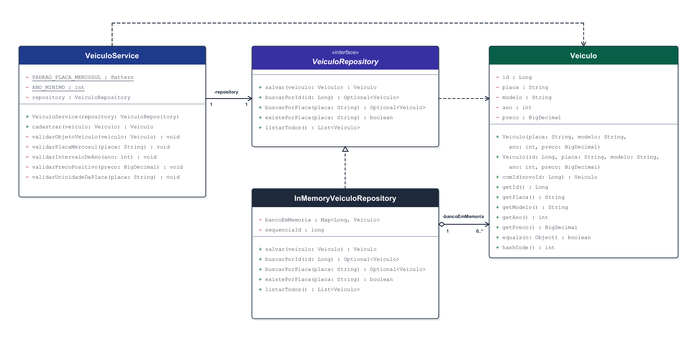
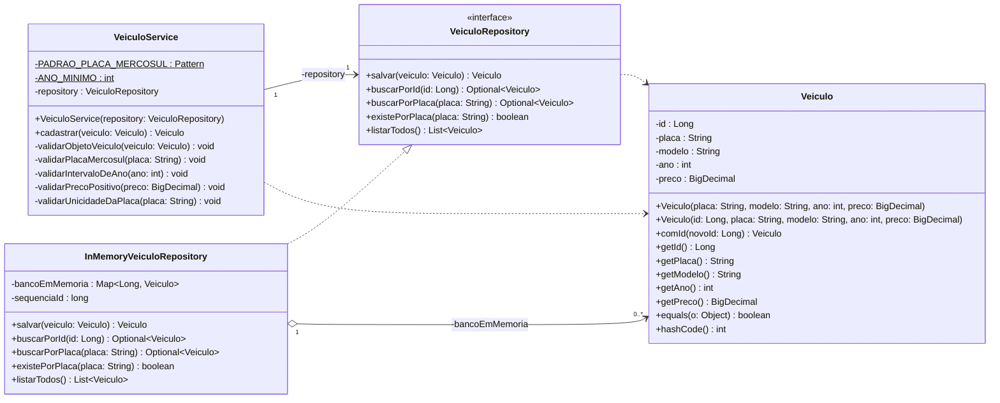
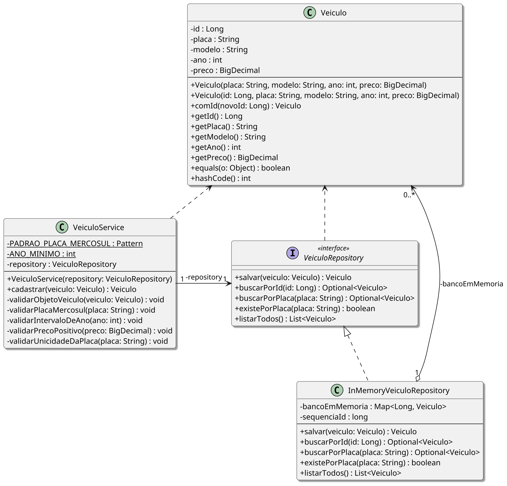

# Diagrama de Classes — Cadastro de Veículos

- [`diagrama_classes.png`](./diagrama_classes.png) — Imagem em Alta Definição.
- [`diagrama_classes.svg`](./diagrama_classes.svg) — Diagrama vetorial escalável (SVG).

## Mermaid

## PlantUML

